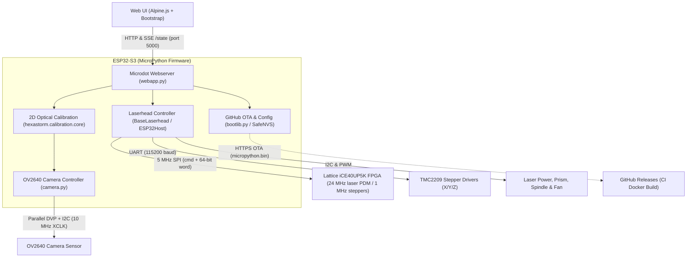

# ESP32-S3 Webserver & Controller for Hexastorm

This project provides an asynchronous Microdot webserver and hardware controller running on an **ESP32-S3** microcontroller (MicroPython), enabling remote operation of a dual-mode PCB fabrication workstation (**UV Laser Lithography** and **CNC Milling**).

The workstation's real-time timing is driven by a Lattice iCE40UP5K FPGA programmed with the [Hexastorm](https://github.com/hstarmans/hexastorm) Amaranth HDL toolchain, tracked as a Git submodule (`deps/hexastorm`) and sharing the pure Python / `ulab` optical calibration core (`hexastorm.calibration.core`).

---

## Architecture Overview



* **Coordinate Persistence & Crash Protection:** Machine (`mpos`) and workspace offset (`woff`) coordinates are persisted in ESP32 NVS in micrometers via `SafeNVS` (`nvs_mock.json` on PC). Boot crashes are tracked in RTC memory (`bootlib.check_crash_loop_rtc()`), entering safe mode after repeated failures and clearing the counter after 5 seconds of stable uptime (`_mark_boot_stable()`).
* **Timing Split on FPGA:** Laser exposures run at `24 MHz` (photodiode-locked scanline events + Sigma-Delta PDM), while coordinated homing, positioning, and CNC G-code moves run on the `1 MHz` forward-difference stepper engine.
* **Clean Dependency Separation:** Application code lives in `src/`, pure-Python vendored MicroPython libraries live in `vendor/` (documented in `vendor/VERSIONS.md`), C/submodule repositories live in `deps/`, the ESP32-S3 MicroPython board definition lives out-of-tree in `boards/HEXASTORM_S3/`, and reproducible firmware compilation runs inside Docker (`Dockerfile`) and GitHub Actions (`.github/workflows/ci.yml`).

---

## Features

* **Coordinated Multi-Axis Motion:** 3D linear interpolation (`G0`/`G1`) across X, Y, and Z axes with per-axis soft limits and E-stop locking.
* **Smart Job Launcher (`.pat` & G-code):**
  * **Laser Mode (`.pat`):** Streams `zlib`-compressed 24 MHz scanline SPI packets. Filename suffixes enforce safe exposure handling: raw `*_e1_nocor.pat` files allow GUI `exposureperline` repetition (scaling the 24 MHz `calc_step_half_period()` step timing) and `singlefacet` mode, whereas pre-sliced / optically corrected files such as `*_e4_cor.pat` already contain 4× (`0.25` step/line) scanlines and are never re-repeated.
  * **CNC Mode (`.gcode`, `.nc`, `.tap`):** On-board G-code interpreter supporting `G90`/`G91`, `G21`, `M3`/`M5` spindle control, and feedrates.
* **Peripherals & Diode Diagnostics:** Remote toggling/control for UV laser, rotating polygon prism, spindle PWM, cooling fan PWM, and photodiode facet jitter measurement (`test_diode` + saved reference `facetmeans`).
* **Live Camera & On-Board 2D Calibration:** OV2640 capture, saved inspection target coordinates, FOV scan visibility, single/all-facet dot preview, and automated 2D facet calibration & verification.
* **Settings & GitHub OTA:** Browser-based configuration for Wi-Fi, static IP, TMC2209/axis parameters, tool offsets, and direct-to-flash OTA updates fed by CalVer-tagged GitHub Releases (`vYYYY.MM.N`, e.g. `v2026.11.1`) built in CI.

---

## Camera & Optical Calibration

The **Camera & Calibration** panel (`camera_panel.html`, `src/control/calibration.py`) shares all DSP and optical math with the main `hexastorm` package via `hexastorm.calibration.core`:

* **Live View & Manual Exposure:** Captures UXGA (`1600×1200`) JPEG snapshots on demand or via auto-refresh. Automatic DSP routines (AEC, AGC, AWB, BPC, WPC) are disabled so manual exposure times (`5 ms`–`1000 ms`, scaled against active frame height `aec_value`) keep laser spot measurements quantitative.
* **SVGA Grayscale Analysis:** `CameraController.analysis_mode()` switches temporarily to SVGA (`800×600`, `4.4 µm/px` effective pixel pitch) grayscale and captures dark frames for background subtraction, guarded by an `asyncio.Lock` so live snapshot refreshes never race FPGA SPI transfers.
* **Scan Visibility & Dot Preview (`F1`–`F4` / `All`):** Maps which `bitsinscanline` coordinates fall within the camera FOV (`visible_pixels`) and projects evenly spaced dots onto individual facets or all facets simultaneously.
* **Calibrate & Verify (2D):** Projects analytical 24 MHz dot events via `PrismCurveLite`, detects sub-pixel 2D centroids (`get_dots_ulab`), removes global camera tilt, computes spatial-median facet shifts using the unified `target - virtual_ref` sign convention (`analyze_facets_ulab`), persists per-facet `(scan, orth)` offsets to `config.json`, and runs `run_pattern_error()` (`slice_dot_grid_events()` + `VirtualStackerUlab`) to verify before/after residual 2D error is `≤ 30 µm`. On CPython, `src/camera.py` delegates analysis captures to `hexastorm.calibration.FakeScanhead` for realistic closed-loop offline simulation.

---

## Repository Map

| Path                                                    | Purpose                                                                                                                                                   |
| :------------------------------------------------------ | :-------------------------------------------------------------------------------------------------------------------------------------------------------- |
| [Dockerfile](Dockerfile), [docker/](docker/)              | Reproducible builder container (`espressif/idf:v5.5.2` + MicroPython `v1.28.0` + `mpy-cross`)                                                       |
| [.github/workflows/ci.yml](.github/workflows/ci.yml)     | Automated `pytest`/`ruff`/`pyrefly` checks, Docker firmware CI builds, and CalVer-tagged OTA releases                                                  |
| [boards/HEXASTORM_S3/](boards/HEXASTORM_S3/)             | Out-of-tree MicroPython board definition (`mpconfigboard.h`, 32 MiB OTA partitions, `esp32-camera` component)                                         |
| [deps/](deps/)                                           | Git submodules (`hexastorm`, `micropython-ulab`, `micropython-camera-API`, `esp32-camera`) — no local symlinks                                   |
| [vendor/](vendor/)                                       | Vendored pure-Python MicroPython libraries (`microdot`, `utemplate`, `ota`, `mrequests`, `winbond`, `tmc`) + [VERSIONS.md](vendor/VERSIONS.md) |
| [src/boot.py](src/boot.py)                               | Early boot logger setup, asset deployment (`constants`), and RTC crash-loop guard                                                                       |
| [src/main.py](src/main.py)                               | Async startup: Wi-Fi manager, NTP sync, optional WebREPL, Microdot server, and 5s stability mark                                                          |
| [src/control/_paths.py](src/control/_paths.py)           | Central path resolver (`HEXASTORM_DIR` override → `deps/hexastorm` → sibling fallback + `vendor/`)                                                |
| [src/control/webapp.py](src/control/webapp.py)           | Microdot routes, session auth middleware, SSE `/state`, upload/delete, motion, and calibration API                                                      |
| [src/control/calibration.py](src/control/calibration.py) | OV2640 calibration orchestration, FPGA SPI lock, `24 MHz` dot projection, and 2D verification                                                           |
| [src/control/camera.py](src/control/camera.py)           | `CameraController`, `AnalysisModeContext`, and OV2640 manual exposure register control                                                                |
| [src/control/laserhead/](src/control/laserhead/)         | `BaseLaserhead` (CPython mock + shared `.pat`/G-code logic) and `Laserhead` (`ESP32Host` + TMC2209)                                               |
| [src/control/bootlib.py](src/control/bootlib.py)         | Wi-Fi STA/AP setup, NTP, GitHub OTA updater, disk/log helpers, and RTC crash counter                                                                      |
| [src/control/constants.py](src/control/constants.py)     | `SafeNVS`, `deploy_assets()`, config migration/merging, and hardware optical constants                                                                |
| [src/camera.py](src/camera.py)                           | CPython mock `camera` module backed by `hexastorm.calibration.FakeScanhead`                                                                           |
| [src/manifest.py](src/manifest.py)                       | Packs `src/root/` via `freezefs` and freezes `control/`, `vendor/`, `deps/` & `hexastorm`                                                     |
| [src/micropython.cmake](src/micropython.cmake)           | Integrates `deps/micropython-ulab` and `deps/micropython-camera-API` into MicroPython build                                                           |
| [src/build.py](src/build.py)                             | One-command firmware builder (`--docker` or native) and host/SSH `esptool` flash CLI                                                                  |
| [src/root/](src/root/)                                   | Web UI HTML templates, `static/home.js`, factory `config.json`, and mock runtime files                                                                |
| [src/tests/](src/tests/)                                 | Pytest endpoint, UI-contract, layout/Docker, and `FakeScanhead` calibration tests + on-device scripts                                                   |

---

## Security

The webserver is protected by session authentication with default password **`hex`** (stored as salted SHA-256 hash in `src/root/config.json`). Change the password before exposing the controller on untrusted networks.

---

## Web Interface Overview

A visual overview of the webserver interface after successful login:


---

## Local Development & Testing

Clone with submodules, install Python dependencies via [uv](https://docs.astral.sh/uv/), and run the webserver locally using the CPython mock laserhead and `FakeScanhead` camera simulator (port `5000`, default password `hex`):

```bash
git clone --recursive https://github.com/hstarmans/esp32_hexastorm
cd esp32_hexastorm
uv sync
uv run webapp
```

When actively developing in a sibling `../hexastorm` checkout, set `HEXASTORM_DIR=../hexastorm` to override `deps/hexastorm`.

Run the automated test suite (`microdot.test_client.TestClient` HTTP endpoint tests, frontend template/JS route contract checks, layout/Docker/pin checks, `FakeScanhead` 2D calibration, and `.pat` packet streaming) and linter:

```bash
uv run pytest
uv run ruff check src
```

---

## Building & Flashing Firmware (Recommended: Docker)

No manual ESP-IDF, MicroPython, or Yosys/nextpnr checkout is needed when using Docker — only `uv` and Docker on the build machine (`esptool` is installed inside the project's `.venv`). Each build automatically synthesizes the iCE40UP5K FPGA bitstream from `deps/hexastorm` (`HEXASTORM_DIR` override supported) and bundles `/sd/fpga/fpga.bit` inside `micropython.bin` via `freezefs` so every fresh flash or OTA update flashes matching FPGA gateware on boot:

```bash
# Synthesize FPGA bitstream + build firmware in Docker and flash over local USB
uv run build --docker

# Compile binaries only (build/HEXASTORM_S3/micropython.bin + src/root/sd/fpga/fpga.bit)
uv run build --docker --build-only

# Use a prebuilt bitstream override instead of running synthesis
uv run build --docker --fpga-bit path/to/top.bin

# Compile locally in Docker and flash over SSH to a remote host
uv run build --docker --remote hexastorm@pihome.home
```

### Releases & OTA Updates (CalVer)

Firmware releases use CalVer tags formatted as `vYYYY.MM.N` (year, two-digit month, sequence number starting at `1`, e.g. `v2026.11.1`), matching the 3-part OTA version check in `src/control/bootlib.py` and baked automatically into `FIRMWARE_VERSION`:

```bash
git tag -a v2026.11.1 -m "Release v2026.11.1"
git push origin v2026.11.1
```

CI gates releases on passing tests (`needs: test`), attaches `micropython.bin` with auto-generated release notes, and marks tags containing `-` (e.g. `v2026.11.1-rc1`) as GitHub pre-releases so OTA `/releases/latest` skips them.

See [developer.md](developer.md) for Docker/CI details, native toolchain setup, `boards/HEXASTORM_S3` architecture, dependency versioning (`vendor/VERSIONS.md`), and the REST API reference.
